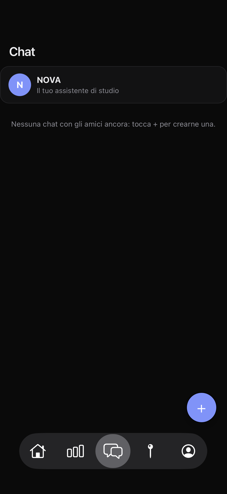
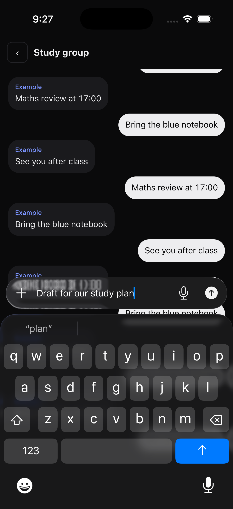

<p align="center">
  
</p>
<h1 align="center">NOVA</h1>
<p align="center"><strong>Studio, persone e giornata. In un unico posto.</strong></p>
<p align="center">Una dashboard per iPhone con compiti, voti, orario, assistente AI e chat.</p>
<p align="center">
  <a href="#installazione">Installazione</a> · <a href="#anteprima">Anteprima</a> · <a href="#stato-del-progetto">Stato del progetto</a> · <a href="#privacy-e-controllo">Privacy</a>
</p>

---

## La tua giornata, a colpo d'occhio

NOVA riunisce il lavoro scolastico e gli strumenti per organizzarlo: compiti e verifiche, calendario, voti, orario e promemoria. L'assistente AI è una chat a cui chiedere aiuto; amici e gruppi hanno conversazioni separate.

Il progetto è in sviluppo attivo. Una build disponibile al download non significa che ogni funzione sia stata verificata su ogni dispositivo. Le novità in corso sono indicate sotto, senza confonderle con le funzioni già presenti.

## Anteprima

<table>
  <tr>
    <td align="center"><br><strong>Chat</strong><br>Assistente e conversazioni in un solo elenco.</td>
    <td align="center"><br><strong>Liquid Glass · In sviluppo</strong><br>Anteprima del composer nativo.</td>
  </tr>
</table>

Screenshot reali di una build di sviluppo nel simulatore iOS, con dati e messaggi sintetici. Non sono chat di utenti reali. Il secondo screenshot mostra lavoro in corso, non una promessa che ogni release abbia già lo stesso risultato su iPhone.

## Già presente nell'app

| Area | Cosa offre |
| --- | --- |
| **Dashboard** | Compiti manuali, calendario, prossime verifiche, batteria e meteo su richiesta. |
| **Scuola** | Collegamento a ClasseViva per importare dati del registro, voti e orario modificabile. |
| **Assistente** | Chat AI tramite Groq con la propria chiave, lettura della foto dell'orario e permessi per le azioni. |
| **Persone** | Account NOVA, username, profili, richieste di amicizia, messaggi e gruppi. |
| **Mappa amici** | Condivisione della posizione facoltativa e modalità Fantasma. Nessuna condivisione da attivare per usare il resto dell'app. |
| **Widget** | Orario, lezioni, fine scuola e calendario. La disponibilità dei dati dipende dalla firma e dall'accesso all'App Group. |
| **Notifiche** | Promemoria locali e integrazione ntfy per avvisi sociali. Richiedono configurazione e permessi; non sono un servizio push nativo APNs. |

"Presente" descrive la funzione disponibile nel progetto, non una garanzia di assenza di bug. Per i limiti pratici, leggi le note di installazione e lo stato qui sotto.

## Stato del progetto

| Stato | Attività | Nota |
| --- | --- | --- |
| 🟡 **In corso** | **Implementazione Liquid Glass** | Composer, navigazione con lente Apple, rifrazione ai bordi e controlli della mappa. Verifiche visive e integrazione su dispositivo ancora in corso. |
| 🟡 **In corso** | Impostazioni organizzate | Nuova pagina opaca a sezioni, scorrimento sotto l’intestazione separato, interruttori nativi Apple e controlli glass. In verifica: nessuna modifica automatica alle scelte o ai permessi. |
| 🟡 **In corso** | Avvisi al centro | Messaggi di stato poco sopra il centro con vetro nativo, lontani dalla barra. Verifica visiva e su dispositivo in corso. |
| 🟡 **In corso** | Pulsanti glass in tutta l'app | Superfici native Apple per i pulsanti di azione e selezione, lasciando i tocchi e i permessi ai controlli originali. Verifiche schermata per schermata ancora in corso. |
| 🟡 **In corso** | Ritorno dalla chat AI all'elenco | Correzione della visibilità dell'elenco e test di navigazione. |
| 🟡 **In corso** | Avatar e isolamento account | Foto del profilo nella navigazione, visibilità tra amici accettati e aggiornamenti al cambio account. |
| 🟡 **In verifica** | Foto, vocali e notifiche | Controlli su annullamento, cambio chat, permessi e comportamento sui dispositivi. |
| 🔜 **Prossimamente** | Consegna delle correzioni in corso | Dopo le verifiche della build. Nessuna data promessa. |

Le voci "In corso" e "Prossimamente" non sono funzioni da considerare concluse. Le priorità possono cambiare in base ai test.

## Installazione

1. Apri [Releases](https://github.com/federicotaranudev/NOVA-ios/releases) e scegli una versione, leggendo le sue note. Le versioni precedenti restano disponibili.
2. Scarica il file `.ipa` della versione scelta. È **non firmato**: serve un metodo di sideloading, per esempio AltStore o Sideloadly.
3. Per aggiornare, mantieni lo stesso identificativo dell'app e installa sopra la copia esistente. Non cancellare l'app come primo tentativo per correggere un problema.

**Requisiti:** iOS 17 o successivo. I nuovi controlli Liquid Glass richiedono iOS 26; sui sistemi precedenti resta l'interfaccia alternativa.

La firma gratuita ha limiti di durata e di App ID. I widget possono richiedere un App ID aggiuntivo. La sincronizzazione tra app e widget può essere limitata se l'App Group non è disponibile con la firma usata.

## Privacy e controllo

- L'account NOVA può salvare online configurazione e dati dell'app per il ripristino. Il progetto non va descritto come "tutto solo sul telefono".
- Credenziali ClasseViva e chiavi dei servizi restano sul dispositivo e non fanno parte del backup NOVA. Le richieste ai servizi usati dall'app passano ai rispettivi fornitori.
- Le conversazioni sociali usano il backend NOVA. Non sono dichiarate cifrate end-to-end.
- La condivisione della posizione è facoltativa. Fantasma disattiva la visibilità; gli orari di aggiornamento contano, e una posizione vecchia non è una posizione in diretta.
- Il codice ntfy personale è privato: non pubblicarlo in screenshot o segnalazioni.

## Limiti da conoscere

- iOS decide quando concedere attività in background. Non c'è una promessa di controllo continuo del registro o di aggiornamenti istantanei ad app chiusa.
- Promemoria e notifiche dipendono dai permessi e dalla configurazione del dispositivo. L'integrazione ntfy richiede l'app ntfy e l'iscrizione al proprio codice.
- L'assistente richiede una chiave Groq e una connessione. Le risposte AI possono sbagliare: controlla i dati importanti prima di usarli.
- Le immagini del simulatore non sostituiscono una verifica sul telefono. Le release di prova possono avere difetti aperti.

## Struttura

```text
Sources/NOVA/NOVAApp.swift    Interfaccia e integrazioni native iOS
Sources/NOVA/nova.html        Dashboard e logica dell'app locale
Sources/NOVAWidget/           Widget iOS
.github/workflows/           Build e controlli automatici
```

Le build vengono pubblicate come release versionate. Le vecchie release vengono conservate, non sostituite dal file di una nuova versione.

### Verifica sincronizzazione foto

Il ripristino del profilo attende il backup account prima di confrontare la foto locale con quella condivisa agli amici. I due caricamenti non partono più in parallelo; le copie in conflitto restano da scegliere, senza sovrascritture automatiche. Se il profilo sul server non contiene una foto, la nuova versione può sincronizzare la foto già conservata sul telefono del proprietario. Non ricostruisce immagini assenti e non copia foto da altri account.

I pulsanti nativi rispettano la dimensione del testo del controllo originale e restano sotto la barra di navigazione, senza spostare i bersagli di tocco. Le schermate di verifica restano separate dai dati reali.

### Copertura controlli personalizzati

La migrazione include il pulsante Nuova chat, giorni del calendario, azioni dei compiti, scelte a chip, reazioni e pulsanti testuali. Le righe chat con foto e anteprima conservano il contenuto originale: la loro presentazione resta da verificare separatamente. Nessun bersaglio di tocco, conferma o permesso viene sostituito.

### Righe chat native

Le righe chat usano una superficie Apple Glass con foto, titolo e anteprima separati. L’immagine fornita dal profilo resta nella riga, senza ricavare foto mancanti o alterare i dati degli amici. Le azioni restano sui controlli originali.

La conversazione e il pannello reazioni nascondono le superfici native della pagina sottostante. Le icone dei compiti sono mappate esplicitamente; le altre icone SVG vengono confrontate dopo normalizzazione del markup.

Il filtro della barra di navigazione non si applica ai pulsanti di un pannello azioni aperto: anche Chiudi mantiene la superficie nativa. Intro e onboarding restano fuori da questa migrazione e non sono dichiarati completati.

### Prima apertura

Le superfici native includono i pulsanti della configurazione iniziale: Indietro, Avanti, Salta, scelte tema/widget e azioni dei servizi. I bersagli originali conservano eventi, conferme e permessi. Nessun servizio viene autorizzato o configurato automaticamente. L’intro conserva il gesto Tocca per saltare e la durata originale: non viene aggiunto un nuovo pulsante né un nuovo passaggio.

### 2026.10.25.29

Anche il selettore foto nella configurazione iniziale usa un pulsante glass: apre lo stesso selettore di sistema e mantiene la gestione originale della foto. Nessuna attivazione automatica di account o permessi. Verifica visiva e su dispositivo ancora distinta.

### 2026.10.25.30

Il selettore del file di personalità dell’assistente usa lo stesso pulsante glass degli altri caricamenti. Tipi di file, lettura locale e conferma del testo restano invariati. Nessun file viene scelto o letto senza il gesto dell’utente.

### 2026.10.25.31

Aprendo agent.md, il focus iniziale va al titolo invece di aprire subito l’editor. Altezza del testo limitata alla finestra: selettore e conferme restano nel dialogo. Lettura locale e salvataggio esplicito invariati.

### 2026.10.25.32

Il dialogo agent.md segue la finestra visibile durante la modifica, con titolo e conferme nel pannello scorrevole. Nessuna modifica ai file, ai permessi o al salvataggio.

### 2026.10.25.33

Prima schermata nativa: Impostazioni usa una lista UIKit con campi, interruttori e azioni nello stesso scorrimento. Non usa più controlli posizionati sopra righe HTML. Lo stato e le conferme restano nei gestori esistenti; le destinazioni separate profilo, orario e introduzione restano disponibili. Il resto dell’app continua la migrazione: non è ancora interamente nativo. Verifica su dispositivo ancora necessaria.

### 2026.10.25.34

Impostazioni native: gruppi dedicati a profilo, nome, account e preferenze; le spiegazioni restano a piè di gruppo invece di diventare righe separate. Intestazione nativa opaca con titolo visibile. Verifiche di scorrimento e azioni in corso.

### 2026.10.25.35

Anche i collegamenti presenti nelle spiegazioni dei servizi hanno un’azione nella pagina nativa. Proseguono i controlli su campi, interruttori, isolamento account e ritorno alle destinazioni esistenti.

### 2026.10.25.36

Editor del profilo in pagina nativa: selettore foto iOS, username, scuola, punti forti, hobby, ricerca canzone e Salva/Annulla. Gestori originali per disponibilità username e salvataggio. La migrazione continua su dashboard, chat, mappa e altre schermate: non sono ancora tutte native.

### 2026.10.25.37

Titolo e azione di chiusura del profilo nativo distinti da Impostazioni. Restano Salva esplicito, Annulla e vincolo del primo profilo.

### 2026.10.25.38

Ricerca canzone nel profilo nativo: risultati aggiornati senza togliere il focus al campo. Username senza maiuscola automatica. Salvataggio del profilo ancora esplicito.

### 2026.10.25.39

Campi nativi con limiti di lunghezza originali, niente correzione automatica username. Cambi account/sessione terminano la modifica del campo prima di aggiornare la pagina. Risultati di ricerca aggiornati anche a parità di numero di righe.

### 2026.10.25.40

Aggiornamenti del modulo nativo preservano il campo attivo anche nelle righe Punti forti e Hobby.

### 2026.10.25.41

Transizioni dei moduli nativi serializzate: una riapertura rapida non viene persa durante la chiusura della pagina precedente.

### 2026.10.25.42

Home nativa UIKit con scorrimento e schede per ora, meteo, batteria, verifiche, compiti, calendario e Spotify. Dati e azioni restano negli handler esistenti; controlli nativi senza coordinate ricavate dal layout HTML. StandBy continua nel percorso originale. Azioni protette da account, sessione, pagina e modali aperti.

### 2026.10.25.43

Home nativa: intestazione con comandi a icone, testo compiti con spazio dedicato, giorni del calendario non spezzati su due righe. Epoch rinnovato anche uscendo e rientrando nella Home.

### 2026.10.25.44

Home nativa con titolo e scadenza compiti separati, marcatori calendario per compiti/verifiche e percentuale batteria. Il saluto viene aggiornato anche a schede invariate.

### 2026.10.25.45

Pagina Voti nativa: media generale, voti recenti e medie per materia con gli stessi calcoli e suggerimenti della versione precedente. Dati ClasseViva e account non modificati.

### 2026.10.25.46

Accesso alle impostazioni dalla pagina Voti nativa mantenendo i controlli account/sessione/modali.

### 2026.10.25.47

Nuovo compito nativo con titolo, descrizione multilinea, data e ora, priorità e promemoria tramite controlli UIKit. Conferma/cancellazione e validazione restano negli handler esistenti.

### 2026.10.25.48

Valori dei menu priorità/promemoria visibili nel modulo nativo; descrizione con etichetta di sezione esplicita.

### 2026.10.25.49

Correzioni da video e schermate reali: rimossi i duplicati nativi posizionati sopra le pagine web che restavano indietro durante lo scroll; i pulsanti originali restano usabili fino alla migrazione di quelle pagine. Spotify nativo a icone con etichette accessibilità. Separatore verifiche/scadenza. StandBy spento e pulsante rimosso. Batteria aggiornata al ritorno in primo piano; valori UIKit indicati come approssimativi, livello sconosciuto mai presentato come100%.

### 2026.10.25.50

L'editor dell'orario usa una pagina UIKit: giorni, lezioni, materie/aula, selettori dell'ora e azioni Salva/Annulla. I dati restano in bozza fino al salvataggio e mantengono lo stesso invio ai widget. L'importazione usa il selettore foto di sistema senza ritagliare la griglia dell'orario, poi lo stesso servizio Groq con la chiave locale. La lettura della foto resta da verificare sul dispositivo e non salva automaticamente il risultato.

### 2026.10.25.51

L'importazione dell'orario scarta i risultati se si chiude la bozza, si cambia account o si avvia una lettura più recente. Il risultato resta da controllare e salvare esplicitamente.

### Correzione privacy del codice pubblico

Rimossi l'orario personale incorporato, il riempimento automatico basato sul nome e la copia nelle prove visive. Nessuna cancellazione dell'orario già salvato sul dispositivo. Il widget non deve sostituire un orario vuoto o assente con lezioni personali incorporate. Le vecchie versioni, i commit e i file distribuiti possono conservare copie e richiedono una verifica separata prima di rendere nuovamente pubblico il progetto. Pubblicazione automatica sospesa durante la bonifica.

### Fondazione Swift (non attiva)

Inizia la sostituzione del modello HTML/JS con dati e persistenza Swift. L'importazione proposta conserva anche chiavi sconosciute, cache dei diversi account e copia di recupero, verifica la rilettura e non elimina la memoria precedente. Non è ancora il motore attivo dell'app: le schermate e i servizi devono raggiungere la stessa copertura prima del passaggio. Nessun orario personale viene incluso nel codice.

### Schermate Swift autonome (in verifica, non attive)

Prima schermata e editor dell'orario leggono e salvano direttamente dal modello Swift, senza modello DOM o azioni JavaScript. L'editor usa una bozza, controlla account e orari, conserva i campi sconosciuti e scrive il formato widget esistente. Non sono ancora il percorso attivo: importazione, servizi e resto delle funzioni richiedono verifica prima del passaggio. Nessuna perdita di funzioni viene nascosta dietro la parola nativo.

Il trasporto account Swift usa gli stessi endpoint e il token dell'account importato. La prima verifica è di sola lettura e scarta risposte dopo un cambio account. Nessun ripristino o caricamento automatico può sovrascrivere la copia locale prima della gestione dei conflitti.

L'offerta di importazione Swift è esplicita: copia una volta la memoria precedente senza cancellarla, con copia di recupero e verifica. Il lettore usa solo la memoria locale dell'origine precedente, senza eseguire le funzioni HTML né fare richieste di rete. Questa strada resta inattiva finché l'importazione sul dispositivo e la parità delle funzioni non sono verificate.

Il percorso Swift in verifica include ora creazione e completamento dei compiti con bozza, controllo duplicati e scrittura atomica del modello Swift. Le notifiche e il backup devono ancora essere collegati prima dell'attivazione: non è una versione finale né una sostituzione silenziosa delle funzioni esistenti.

Il percorso compiti Swift aggiorna il file widget e pianifica i promemoria solo con autorizzazione già concessa. Nessuna richiesta automatica di permessi durante l'importazione. L'esito di programmazione non promette la consegna iOS; verifica del dispositivo ancora necessaria.
